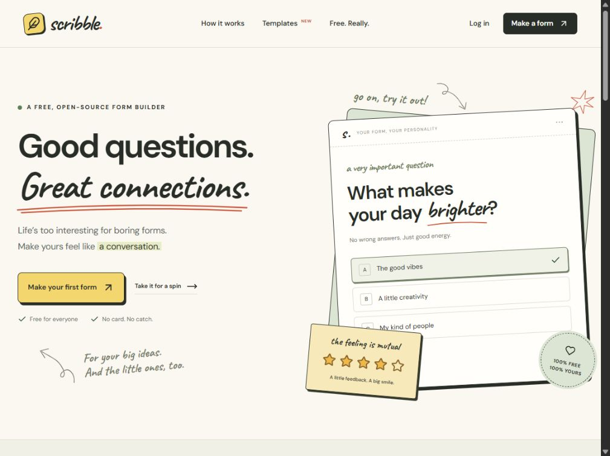
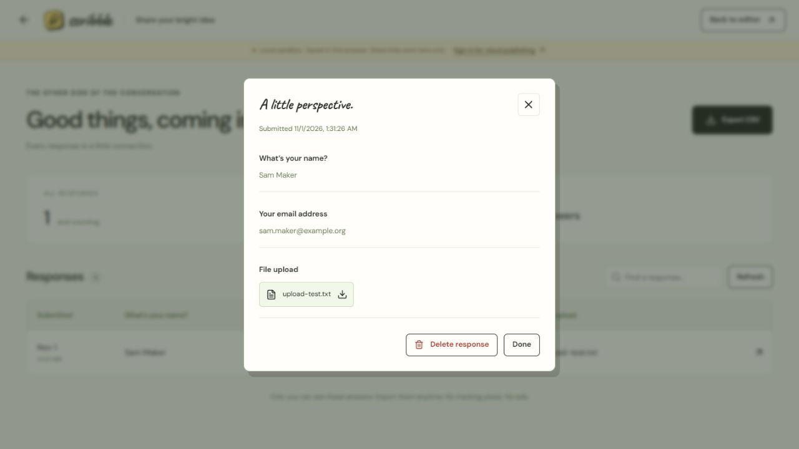

<p align="center">
  
</p>

<p align="center">
  <strong>Forms with a little personality.</strong><br />
  A free, self-hostable form builder for students, creators, communities, and everyone with a question.
</p>

<p align="center">
  <a href="https://github.com/husnain381a/Scribble-Forms/actions/workflows/ci.yml"></a>
  <a href="LICENSE"></a>
  <a href="https://nodejs.org/"></a>
  <a href="CONTRIBUTING.md"></a>
</p>

<p align="center">
  <a href="#quick-start">Quick start</a> ·
  <a href="#what-you-can-make">Features</a> ·
  <a href="docs/DEPLOYMENT.md">Self-hosting</a> ·
  <a href="CONTRIBUTING.md">Contribute</a> ·
  <a href="SECURITY.md">Security</a>
</p>

## A little less form. A little more conversation.

Club sign-ups. Research surveys. Event RSVPs. Feedback that feels like a conversation. Scribble gives everyday questions a warmer home, with handwritten details, flexible themes, and an editor you can get comfortable in.

The application has **no paid feature tiers**. Run it locally, read the code, and host your own instance. Your hosting, database, storage, and email providers still have their own quotas and costs.



## Quick start

You need **Node.js 22+** and npm. Supabase and Docker are optional for trying the browser-local sandbox.

```sh
git clone https://github.com/husnain381a/Scribble-Forms.git
cd Scribble-Forms
npm ci
npm run dev
```

Open [http://localhost:3000](http://localhost:3000). Create a form, try the themes, preview it, and test a response. No API keys are required for the sandbox.

> **Sandbox links stay local.** Sandbox forms and responses live in your browser profile; files use IndexedDB. A sandbox share link cannot collect responses from other people or devices. For real shared forms and accounts, connect your own Supabase project below. Local drafts are not automatically transferred to cloud accounts.

## What you can make

| Part               | Included                                                                                                                                          |
| ------------------ | ------------------------------------------------------------------------------------------------------------------------------------------------- |
| Questions          | Short and long answers, email, phone, number, URL, date, single choice, checkboxes, dropdown, stars, scales, files, consent, and section headings |
| Personality        | Six themes, three font styles, custom accent colors, page or conversational layouts, custom submit text, and thank-you screens                    |
| Editor             | Autosave, conditional question chains, required answers, drag/up/down reordering, duplicate/remove, undo/redo, and mobile/desktop preview         |
| Starting points    | Templates for events, feedback, student research, contact forms, clubs, and creative briefs                                                       |
| Sharing            | Immutable published snapshots, share links, close/reopen forms, and protection against submitting an outdated version                             |
| Responses          | Owner-only dashboard, search, response details, deletion, and CSV export with formula neutralization                                              |
| Accounts and files | Supabase email/password accounts and recovery, owner-based RLS, private storage, signed upload tickets, and short-lived owner downloads           |
| Open source        | AGPL-3.0 source, SQL migrations, local tests, cloud verification scripts, and a corresponding-source download generated with each build           |

<details>
  <summary><strong>A look at the response dashboard</strong></summary>



This screenshot uses invented demonstration data. Real responses are available only to the form owner through the application.

</details>

## Make it your own instance

Follow the [Supabase + Vercel deployment guide](docs/DEPLOYMENT.md) for the complete setup.

1. Create a Supabase project you control.
2. Apply **all SQL migrations** in `supabase/migrations/`, in filename order, once per project. The guide also covers using the Supabase CLI.
3. Copy `.env.example` to `.env.local` and fill in your project's values.
4. Configure Auth redirects and email delivery, then sign up and confirm your account.
5. Build and run locally, or deploy the app to Vercel using the Next.js preset.

| Environment variable                   | Purpose                                                         | Browser safe?        |
| -------------------------------------- | --------------------------------------------------------------- | -------------------- |
| `NEXT_PUBLIC_SUPABASE_URL`             | Your Supabase project URL                                       | Yes                  |
| `NEXT_PUBLIC_SUPABASE_PUBLISHABLE_KEY` | Your publishable API key                                        | Yes                  |
| `SUPABASE_SECRET_KEY`                  | Privileged, server-only API credential                          | **No**               |
| `RATE_LIMIT_SECRET`                    | Random value of at least 32 characters for hashed rate counters | **No**               |
| `APP_ORIGIN`                           | Exact instance origin, such as `http://localhost:3000`          | Public configuration |

Never put a server credential in a `NEXT_PUBLIC_*` variable, browser code, or a commit. This repository contains configuration examples, not a shared backend or hosted service. See [SECURITY.md](SECURITY.md) for the access model and operator responsibilities.

## Development and checks

```sh
npm test                 # Form logic and real SQL/RLS checks in PGlite
npm run typecheck        # TypeScript
npm run format:check     # Formatting
npm run build            # Source download + production build
npm start                # Serve the production build locally
```

The local test suite covers field validation, conditional visibility, templates, CSV exports, sandbox behavior, SQL ownership, immutable versions, rate counters, file boundaries, and script policy. GitHub CI runs local checks without cloud credentials.

For your own configured project and a running production app:

```sh
npm run test:security       # Built-asset/source credential checks and HTTP security headers
npm run test:cloud:managed  # Creates, verifies, and cleans up two disposable test accounts
```

Cloud verification exercises actual Auth, PostgREST, publishing, submissions, and private file access. It requires the server credential and creates synthetic data in your project; it sends no email. The [deployment guide](docs/DEPLOYMENT.md#6-full-cloud-verification) also explains using existing test accounts. Never run tests against a project you do not control.

## How it fits together

```text
src/app/                Pages and validated Next.js API routes
src/components/         Editor, form renderer, workspace, and response views
src/lib/forms.ts        Shared form schemas, answer rules, and CSV helpers
src/lib/repository.ts   Local sandbox / authenticated cloud persistence
src/lib/server.ts       Server-only clients, ownership, limits, and public reads
src/proxy.ts            Per-request script nonces and content security policy
supabase/migrations/    Schema, owner policies, functions, and private storage
scripts/                Source packaging, checks, and upload maintenance
tests/                  Form, PostgreSQL/RLS, and security regression tests
docs/                   Deployment instructions and reusable brand assets
```

Creators work through their signed-in RLS context. Public respondents use validated server endpoints; they cannot directly read response tables. Every response references an immutable published version. Files use non-overwriting signed uploads and owner-authorized downloads. HTML uses a fresh script nonce and dynamic rendering.

## Contributions are welcome

You do not need to start with a large feature. A clearer label, a keyboard-navigation fix, a useful template, or a better setup explanation all help.

- Read [CONTRIBUTING.md](CONTRIBUTING.md) to get started.
- [Report a bug](https://github.com/husnain381a/Scribble-Forms/issues/new?template=bug_report.yml) with a small, reproducible example.
- [Suggest an improvement](https://github.com/husnain381a/Scribble-Forms/issues/new?template=feature_request.yml) and explain who it helps.
- Follow the [code of conduct](CODE_OF_CONDUCT.md). Report security issues through the process in [SECURITY.md](SECURITY.md).

For larger changes, open an issue before investing substantial time so we can agree on the approach. This is an early project; there is no response-time or compatibility guarantee.

## Scope and practical limits

The current core includes the workflows listed above. Teams/roles, payments, webhooks, third-party integrations, existing-form imports, per-form custom domains, signatures, and CAPTCHA are not included. Feature requests and focused contributions are welcome; this is not a promised delivery schedule.

Private responses are protected by access controls, not end-to-end encryption. Instance administrators can access their database. File contents are not virus-scanned, and rate limits are not complete bot/DDoS protection. Before a public launch, configure email, backups, retention, scheduled upload cleanup, and quota monitoring using the [deployment guide](docs/DEPLOYMENT.md#7-maintenance).

## License and credits

Scribble is licensed under **AGPL-3.0-only**. See [LICENSE](LICENSE), [NOTICE.md](NOTICE.md), and the license's terms for distributing changes or providing a modified network service. Third-party dependencies retain their own licenses.

Built with Next.js, React, TypeScript, Supabase, Zod, Lucide, and locally served Fontsource fonts. Product screenshots use demonstration data; the banner and logo assets live in [`docs/assets`](docs/assets).

<p align="center"><strong>Good questions. Great connections.</strong><br />Made for everyone, with a little scribble.</p>
